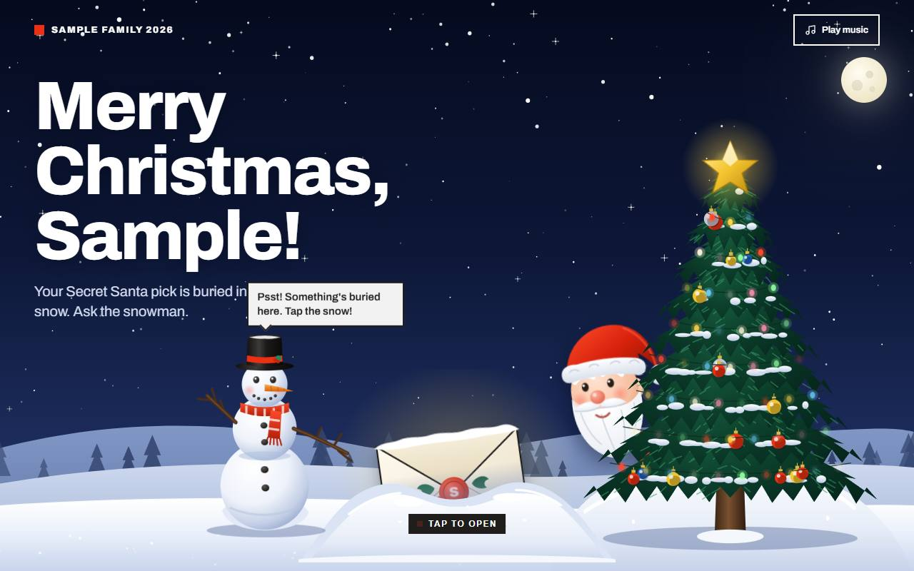

# 🎁 Exchange Gift

A private, self-hosted **secret gift exchange** website (Secret Santa, Kris Kringle, Monito Monita…). The organiser creates a group, adds the participants and generates a secure random draw. Every participant gets **one personal link** and discovers who they are buying for through an animated, mobile-friendly Christmas reveal.

- ASP.NET Core Razor Pages on **.NET 10**, Entity Framework Core + **SQLite** (a single local file, no database server)
- Administrator login with ASP.NET Core Identity
- Two ready-made Christmas themes, chosen per group
- Works on phones, tablets and desktops

## 🎄 Theme Previews

Choose between two festive, interactive reveal experiences for your gift exchange groups.

### ❄️ Default Secret Santa Reveal



A snowy Christmas night. Tap the envelope buried in the snow, then brush the snow off the card to uncover the recipient's name. Includes an optional Christmas music track.

### 🎆 Dubai Family Christmas 2026


A spectacular Dubai skyline at night. Press and hold the gold button to light up the Burj Khalifa as fireworks reveal the recipient's name. Sound is synthesised in the browser.

> Changing a group's theme only changes its appearance. It never changes the gift draw.

## Features

| For the organiser (admin) | For participants |
| --- | --- |
| Create unlimited groups with a friendly URL (`/family-christmas-2026`) | One private link per person (`/family-christmas-2026/AB12CD`) |
| Pick a theme per group (with previews) and switch it any time | Animated reveal that works with touch, mouse and keyboard |
| Add names one by one or paste a whole list | Shows the name of the person they are buying for |
| Secure draw: nobody draws themselves, everybody is drawn once | Optional wish list of the person they drew (up to 3 wishes) |
| Copy every personal link (or all links at once) | Same result every time they open the link |
| See who has revealed (and when); recipients hidden behind an eye button | Music and sound are optional and never required |
| Reset, archive, expire or delete a group | |

### Available Themes

| Key | Name | Experience |
| --- | --- | --- |
| `default-secret-santa-reveal` | **Default Secret Santa Reveal** | Snowy night, interactive envelope, snow-brushing reveal and optional Christmas music. |
| `dubai-family-christmas-2026` | **Dubai Family Christmas 2026** | Dubai skyline, illuminated Burj Khalifa, fireworks and browser-generated sound. |

## Quick start (run it on your own computer)

Requirements: the [.NET 10 SDK](https://dotnet.microsoft.com/download) and Git.

```powershell
git clone <this-repository-url>
cd <repository-folder>

# 1) choose the administrator password (user name: Administrator)
dotnet user-secrets set "Admin:Password" "YourStr0ngPassword" --project src/ExchangeGift.Web

# 2) run the site (the database is created automatically)
dotnet run --project src/ExchangeGift.Web
```

Open the address printed in the console (for example `http://localhost:5000`) and go to **`/admin`**. The sign-in page is **`/admin/login`** (going to `/admin` sends you there automatically when you are signed out). If you ever land on an error or a blank page, go back to `/admin` (add it to the end of your site address, e.g. `https://your-site/admin`).

Password rules: at least 8 characters with an uppercase letter, a lowercase letter and a number.

> Type the password **without** `<` `>` brackets. After the first start the password is stored (hashed) in the database, so changing the setting later does nothing. To reset it see [docs/USAGE.md](docs/USAGE.md#forgot-the-admin-password).

## Documentation

| Guide | What it covers |
| --- | --- |
| [docs/USAGE.md](docs/USAGE.md) | Step-by-step: create a group, run the draw, share links, wish lists, backups, troubleshooting |
| [docs/DEPLOYMENT.md](docs/DEPLOYMENT.md) | Detailed hosting guides: your own PC + Cloudflare tunnel, **SmarterASP.NET**, **Azure App Service** (with GitHub Actions), any IIS server |

## Security in short

- Admin area needs a login **and** an antiforgery token on every change; five wrong passwords lock the account for ten minutes.
- Participant codes are random (cryptographic generator), six characters, unique per group, and validated together with the group name. Wrong links all show the same generic message. Requests are rate limited.
- The draw is stored only on the server. A participant's page never contains anyone's result until they start the reveal, and the answer is not cached.
- The database file lives in `App_Data/` (outside `wwwroot`) and is never served.
- Strict response headers and Content-Security-Policy (no inline scripts).

## Project layout

```text
src/ExchangeGift.Web
  Program.cs                      startup, authentication, rate limiting, headers
  Data/                           entities, DbContext, EF Core migrations
  Services/                       group/draw logic, reveal service, codes, slugs, themes
  Pages/                          public pages, participant page, Admin/*
  Pages/Shared/Themes/            one Razor partial per theme
  wwwroot/themes/<theme-key>/     theme.css, theme.js, fonts (and music for the default theme)
  wwwroot/themes/shared/          theme-kit.js (data binding + the secure reveal request)
  web.config                      IIS / SmarterASP.NET / Azure configuration
tests/ExchangeGift.Tests          xUnit unit and integration tests
scripts/                          Windows helper scripts (start site, tunnel, backup)
docs/                             usage and deployment guides
.github/workflows/                sample GitHub Actions deployment to Azure
```

Run the tests with `dotnet test`.

## Credits

Created by **John Wayne H. Rebustes**  
· [johnwayne.rebustes@gmail.com](mailto:johnwayne.rebustes@gmail.com)  
· [johnwayne.is-a.dev](https://johnwayne.is-a.dev)

The same credit is shown in the admin area under **Credits**. Please keep it when you reuse or modify the project.

Add a `LICENSE` file of your choice to the repository before publishing it.